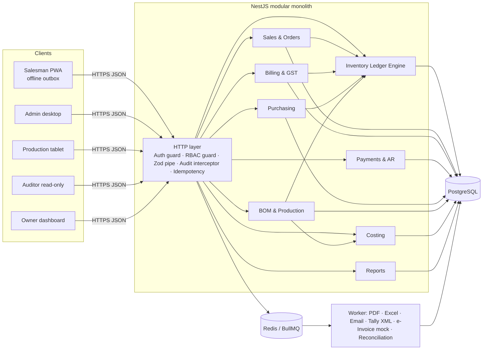
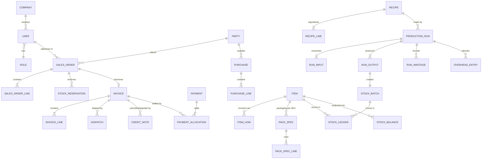

# Order-to-Audit System — Architecture & Build Spec

**Client:** small packaged-snacks manufacturer (Tamil Nadu). **Purpose:** NIT Trichy CDI internship shortlisting task.
**This file is the single source of truth.** Every agent reads it before writing code. If code and this file disagree, fix the code or raise a change request; never silently diverge.

---

## 0. Non-negotiables (from the brief, turned into rules)

1. **Enter once, at source.** No screen re-keys data that already exists in the system.
2. **Ledger first.** Stock balances are a projection of an append-only `stock_ledger`. Nothing ever overwrites a balance directly. A reconciliation check proves `balance == SUM(ledger)` for every item.
3. **No floats for money or quantity.** PostgreSQL `NUMERIC` in storage, `decimal.js` (via Prisma `Decimal`) in code. Money `NUMERIC(14,2)`, quantity `NUMERIC(14,4)`, unit cost/WAC `NUMERIC(14,6)`.
4. **Traceability.** Every ledger row carries `source_type`, `source_id`, `source_line_id`.
5. **Immutability after posting.** Posted invoices and production runs are never edited or deleted. Invoices are cancelled with a credit note; runs are reversed with a reversal document.
6. **Audit trail.** Every create/update/post/cancel writes `audit_log` (user, time, before, after, IP, request id).
7. **Default-deny RBAC.** An endpoint without an explicit permission decorator fails the build-time test.
8. **The benchmark is an automated test.** `pnpm benchmark` replays section 5 against a freshly seeded DB and asserts every expected number.

---

## 1. Stack and why

| Layer | Choice | Why |
|---|---|---|
| Monorepo | pnpm workspaces + Turborepo | One repo, shared types, cached builds, one CI. |
| Web (all roles) | Next.js (App Router) + TypeScript, installable **PWA** | One codebase serves the salesman phone, the admin desktop and the floor tablet; PWA gives offline order capture without app-store friction. |
| UI | Tailwind CSS + shadcn/ui (Radix), TanStack Query, TanStack Table, React Hook Form + Zod, Recharts, cmdk | Accessible primitives, fast data grids, form validation shared with the API. |
| Offline | Serwist (service worker) + Dexie (IndexedDB) outbox | Cached catalogue + queued orders that sync when the network returns. |
| API | NestJS (modular monolith) + Prisma | Modules map 1:1 to bounded contexts; guards/interceptors give clean RBAC and audit hooks; a module can later be split into a service without rewrites. |
| Database | PostgreSQL 16 | Transactions, row locks, `NUMERIC`, triggers for append-only ledger, partitioning when volume grows. |
| Jobs | BullMQ on Redis, run by the **same API codebase** with a second entrypoint (`main.worker.ts`) | PDF rendering, exports, emails, nightly reconciliation off the request path. No duplicated business code. |
| Documents | `@react-pdf/renderer` (invoice PDF), ExcelJS (xlsx), CSV streams | Light containers, deterministic output. |
| Auth | Argon2id + short-lived JWT access token + rotating refresh token (httpOnly cookie) | Stateless API that scales horizontally, with revocation through refresh-token families. |
| Tests | Vitest (unit + integration on real Postgres), Playwright (e2e, mobile viewport) | Stock and tax maths tested where it lives; benchmark tested end to end. |
| Run | Docker Compose: `postgres`, `redis`, `api`, `worker`, `web`, `mailpit`, one-shot `migrate-seed` | `docker compose up --build` is the whole setup. |

**Why a modular monolith, not microservices:** the domain has one tight transactional core (stock + money must change atomically). Splitting that across services would add distributed-transaction risk with no benefit at this scale. Boundaries are enforced in code (module imports only through each module's public service), so extraction stays possible.

---

## 2. System architecture



**Rule:** only `InventoryModule.postMovements()` writes to `stock_ledger` / `stock_balances`. Every other module calls it inside its own transaction.

---

## 3. Repository layout

```
/
├─ apps/
│  ├─ web/                 Next.js PWA. Route groups: (auth) (sales) (admin) (production) (audit) (owner)
│  └─ api/                 NestJS. src/main.ts (HTTP) + src/main.worker.ts (BullMQ)
│     ├─ prisma/           schema.prisma, migrations/, seed.ts (section 5 data)
│     └─ src/modules/      auth, users, parties, catalog, uom, inventory, purchasing,
│                          production, costing, sales, billing, payments, reports,
│                          integrations, audit, dashboard
├─ packages/
│  └─ shared/              THE single source for: enums, Zod DTO schemas, permission matrix,
│                          money/qty helpers, UoM conversion, GST calculator, variance calculator,
│                          order/run state machines, FY + invoice-number helpers
├─ e2e/                    Playwright specs incl. benchmark.spec.ts
├─ docs/                   ARCHITECTURE.md (this), DESIGN_NOTE.md (≤2 pages), adr/, agents/
├─ docker-compose.yml
└─ .github/workflows/ci.yml
```

Frontend never re-implements domain maths; it imports from `packages/shared` (for live previews) and the API recomputes authoritatively.

---

## 4. Data model

Every business table has `id (uuid v7)`, `company_id` (multi-tenant ready; one company seeded), `created_at`, `created_by`, `updated_at`, `version` (optimistic lock).



### Key tables (abridged)

| Table | Important columns |
|---|---|
| `item` | sku, name, `kind` (RAW, PACKAGING, FINISHED, WIP), `base_uom`, hsn, gst_rate, net_weight_g (FG), shelf_life_days, reorder_level, `cost_method` (WAC for RAW/PACKAGING, BATCH_ACTUAL for FINISHED) |
| `uom` | code (KG, G, L, ML, PCS, PKT, CTN), dimension (MASS, VOLUME, COUNT) |
| `item_uom` | item_id, uom, `factor_to_base` (e.g. Murukku 200 g: CTN = 20 PKT). Global conversions (KG↔G, L↔ML) live in `packages/shared`. |
| `recipe` | product family (e.g. Murukku), `batch_output_kg` (40.000), tolerance_pct (3.00) |
| `recipe_line` | recipe_id, item_id, qty_per_batch, uom |
| `pack_spec` / `pack_spec_line` | per FG SKU: packaging qty **per packet** (pouch 1, carton 0.05) |
| `party` | kind (CUSTOMER_RETAILER, CUSTOMER_DISTRIBUTOR, SUPPLIER), gstin, `state_code`, price_list_id, assigned_salesman_id, credit_days |
| `price_list` / `price_list_item` | item_id, rate, valid_from |
| `sales_order` | number, party_id, salesman_id, status, `client_uuid` UNIQUE (offline idempotency), geo_lat/lng |
| `stock_reservation` | order_line_id, item_id, qty — soft allocation, not a ledger movement |
| `invoice` | number, fy, `place_of_supply` (state code), supply_type (INTRA/INTER), taxable, cgst, sgst, igst, round_off, total, status (DRAFT, POSTED, CANCELLED), irn (mock) |
| `invoice_line` | item, hsn, qty, rate, taxable, gst_rate, cgst, sgst, igst |
| `document_sequence` | (company, doc_type, fy) → next_no, locked `FOR UPDATE` when issuing |
| `production_run` | number, recipe_id, status (DRAFT, POSTED, CLOSED, REVERSED), batch_factor, run_date |
| `run_input` | item_id, std_qty, actual_qty, uom, unit_cost, value, variance_pct, flagged |
| `run_output` | fg_item_id, expected_qty, good_qty, batch_id |
| `run_wastage` | item_id, qty, reason (DAMAGED_PACKAGING, YIELD_LOSS, SCRAP) |
| `overhead_entry` | type (LABOUR, GAS_POWER, OTHER), amount, run_id nullable, period (YYYY-MM) |
| `stock_batch` | item_id, batch_no, mfg_date, expiry_date, unit_cost (FG actual cost) |
| `stock_ledger` | item_id, batch_id?, txn_at, `qty_in`, `qty_out` (base UoM), unit_cost, value, `balance_qty_after`, `balance_value_after`, `movement_type` (OPENING, PURCHASE, ISSUE, PRODUCE, WASTAGE, DISPATCH, RETURN, ADJUST, COST_ADJ), `source_type`, `source_id`, `source_line_id`, created_by. **DB trigger rejects UPDATE/DELETE.** |
| `stock_balance` | (item_id, batch_id) PK, qty, value, wac. Projection updated in the same transaction as the ledger insert. |
| `payment` / `payment_allocation` | mode, ref, amount; allocated to invoices oldest-first by default |
| `audit_log` | actor_id, action, entity, entity_id, before jsonb, after jsonb, ip, request_id, at |
| `idempotency_key` | key, user_id, response_hash, created_at (24 h TTL) |
| `refresh_token` | family_id, hash, expires_at, revoked_at, replaced_by |

**Pack-size design (anticipates the interview change "add 500 g sharing the same BOM"):** the food recipe is defined per product family in kg (40 kg flour + 10 L oil + 1.2 kg spice → 40 kg Murukku). Packaging is defined per SKU in `pack_spec`. Expected packets = `batch_output_kg × batch_factor ÷ net_weight_kg`. 200 g → 200 packets. Adding Murukku 500 g = one new `item`, one `pack_spec`, one price — zero changes to the recipe or code. The UI still shows the combined BOM exactly as the brief's table.

---

## 5. Core engines (all pure functions in `packages/shared`, called by API services)

### 5.1 Units
Convert to base UoM at the API boundary; ledger stores base quantities only. Conversion = global factor (KG/G, L/ML) or item-specific `item_uom` factor (CTN→PKT). Cross-dimension conversion (L↔KG) is refused unless an item density is defined. All results are `Decimal`, rounded to 4 dp only at storage.

### 5.2 Ledger posting (`InventoryService.postMovements(tx, movements[])`)
1. Sort movements by `(item_id, batch_id)` — consistent lock order, prevents deadlocks.
2. `SELECT … FROM stock_balance WHERE … FOR UPDATE` for all touched keys.
3. For each movement:
   - **IN (WAC items):** `new_wac = (old_value + in_value) / (old_qty + in_qty)`.
   - **OUT (WAC items):** `value = qty × wac`; if `qty == balance_qty`, `value = balance_value` (clears residual paise so value never drifts).
   - **OUT (FG):** cost = the batch's `unit_cost` (batch-actual costing).
   - Negative stock is rejected (`InsufficientStockError` with item, needed, available).
4. Insert ledger row with `balance_*_after`; update `stock_balance`.
5. All in the caller's transaction. Nightly worker job + `GET /inventory/reconcile` assert `stock_balance == SUM(ledger)`.

### 5.3 BOM, production run and variance
Run lifecycle: `DRAFT → POSTED → CLOSED`, or `POSTED → REVERSED` (reversal document mirrors every movement).

- **Draft:** supervisor picks recipe + FG SKU + batch factor; system pre-fills standard issues; supervisor edits actual issue quantities, good output, damaged packaging, cartons used. Live variance preview as they type.
- **Post (one transaction):** OUT raw materials (actual qty, WAC); OUT packaging (good packets + damaged); create FG batch (`MUR200-YYMMDD-NN`, expiry = mfg + shelf life); IN finished goods at provisional cost = material cost ÷ good output; write wastage rows; compute and store variances; raise alerts.
- **Close:** overheads attached to the run are final; actual cost per packet = (material + overheads) ÷ good output. The overhead difference is posted as a value-only `COST_ADJ`: share still on hand in that batch goes to inventory, share already dispatched goes to COGS adjustment (remainder method, so paise sum exactly).

**Variance rules (documented, tolerance strictly > 3%):**
- Ingredients: `(actual − standard_for_batch) / standard_for_batch`. They are issued per batch before output is known.
- Packaging: standard = good output × per-packet spec, because packaging is consumed per packet packed.
- Yield: `(good_output − expected_output) / expected_output`.

### 5.4 Costing
- **Raw & packaging: moving weighted average cost (WAC).** Commodity inputs bought in mixed lots and blended in the kettle — no lot identity survives, so WAC reflects real consumption cost, smooths price swings, and is permitted by Ind AS 2 / AS 2. FIFO figure is shown alongside as a sensitivity in the costing report.
- **Finished goods: batch actual cost** (each run's batch carries its own cost; dispatch is first-expiry-first-out).
- **Normal losses** (damaged pouches, yield shortfall within reason) are absorbed into good packets. Abnormal loss tagging is listed as a known gap.
- **Overheads:** amounts entered against a run are charged to that run. Monthly overheads with no run are allocated across the month's runs **in proportion to kg of good output** (fryer and gas time scale with mass fried). Rule is configurable (`kg_output` | `batches`).
- **Margin** = selling price (ex-GST) − cost per packet.

### 5.5 GST
- Company state code 33 (Tamil Nadu). Place of supply = customer's state code (from GSTIN's first two digits, or address state if unregistered).
- Same state → CGST + SGST at half rate each; different state → IGST at full rate.
- Tax computed per line, rounded half-up to paise; invoice total = Σ lines; optional rupee round-off line.
- Invoice number: `INV/2627/00001` (≤ 16 chars, unique per financial year April–March), issued from `document_sequence` under row lock at POST time only (drafts have no number, so cancelled drafts never leave gaps).
- GSTIN validated with the official mod-36 checksum. Seed GSTINs must be generated to pass it.
- HSN for namkeen assumed 2106 90 99 at 5% (brief's instruction; confirm with accountant).

### 5.6 State machines (in `packages/shared`, enforced by API — illegal transitions return 409)
```
Order:   SUBMITTED → APPROVED | PARTIALLY_APPROVED | ON_HOLD | REJECTED
         APPROVED/PARTIALLY_APPROVED → INVOICED → DISPATCHED → CLOSED
         SUBMITTED/ON_HOLD/APPROVED → CANCELLED   (releases reservations)
Invoice: DRAFT → POSTED → CANCELLED (only via credit note)
Run:     DRAFT → POSTED → CLOSED ; POSTED → REVERSED
```
**Shortage handling:** approval checks `available = on_hand − reserved`. If short, the admin sees the gap and three choices: approve available quantity and create a backorder for the rest, hold the whole order, or reject. The panel also suggests production ("short 32 packets → 1 batch of Murukku 200 g clears all pending orders").

---

## 6. Security and role management

**Authentication:** Argon2id hashes; login rate-limited (5/min/IP + account lockout after 10 failures); access JWT 15 min (in memory on client); refresh token 7 days in `httpOnly; Secure; SameSite=Strict` cookie, rotated on every use, reuse of an old token revokes the whole family.

**Authorization:** permission matrix defined once in `packages/shared/permissions.ts`; API uses `@RequirePermission()` + global guard (default deny); UI uses the same matrix only to hide controls. **Data scoping** in the service layer: salesmen see only their own orders and their assigned customers.

| Permission | Salesman | Admin | Production | Auditor | Owner |
|---|:-:|:-:|:-:|:-:|:-:|
| order:create, order:read:own | ✔ | | | | |
| order:read:all, order:approve, invoice:post, dispatch:create, payment:create | | ✔ | | | ✔ (read) |
| invoice:cancel (credit note) | | ✔ | | | ✔ |
| purchase:create, production:run, production:post | | | ✔ | | |
| bom:manage, master:manage | | ✔ | ✔ (BOM) | | ✔ |
| overhead:create, production:close | | ✔ | ✔ | | ✔ |
| report:read, report:export | | ✔ | ✔ (stock & production) | ✔ | ✔ |
| dashboard:read, user:manage, audit:read | | | | ✔ (audit) | ✔ |

Auditor is read-only by construction: no mutating permission exists for the role, and report endpoints run through a Prisma client connected as a Postgres role with `SELECT`-only grants (defence in depth).

**Other controls:** Zod validation on every request body/query; Helmet + strict CSP; CORS allowlist; CSRF protection on the refresh endpoint; invoice share links are HMAC-signed, expire in 7 days, and expose only that PDF; secrets only via env (`.env.example` committed, `.env` never); structured logs never contain tokens or GSTIN-linked personal data; dependency audit in CI.

---

## 7. Offline order capture

- On login the PWA caches the salesman's customers, products, price list and a `catalog_version`.
- New orders are written to the Dexie outbox with a `client_uuid` and shown as "Queued".
- Sync triggers: Background Sync API, `online` event, app foreground, manual "Sync now". Exponential backoff, max 6 attempts per sync cycle, then the order shows "Needs attention" — no infinite retry loop.
- Server `POST /orders` is idempotent on `client_uuid`: a repeat returns the existing order (no duplicates).
- Server always re-prices from the current price list; if the catalogue version changed, the admin sees a "price changed since capture" badge.

---

## 8. API conventions

REST under `/api/v1`, OpenAPI generated by Nest Swagger. Cursor pagination. Errors follow RFC 7807 (`type`, `title`, `detail`, `code`). Mutations accept `Idempotency-Key`. Optimistic locking via `version` → 409 on conflict. Long work (PDF, exports) returns `202` + job id; the client polls or receives an SSE event. Request id propagated to logs and audit rows.

---

## 9. UI/UX by role

Design system: shadcn/ui tokens, light/dark, Inter + Noto Sans Tamil, 8-pt spacing, WCAG 2.2 AA contrast, touch targets ≥ 44 px, skeleton loaders, optimistic updates, empty states that say what to do next, toast + undo where reversible. English/Tamil toggle (next-intl) at least for production screens.

- **Salesman (mobile, < 1 minute order):** home shows recent customers + offline/queued badge → tap customer → product list with +/− steppers, packets/cartons toggle, stock hint (In stock / Low / Out) → sticky footer with total incl. GST → Submit. Order history with status chips; customer-wise sales tab. GPS check-in captured silently on submit (if permitted).
- **Admin (desktop):** order inbox as split view; each line shows a coverage chip (green covered / amber partial / red short); edit qty/price inline; keyboard shortcuts (A approve, R reject, H hold); one click "Post invoice" → PDF preview → Dispatch → Share (WhatsApp/Email/UPI QR). Command palette (Ctrl+K) to jump to any customer, invoice or item.
- **Production (tablet):** three-step wizard: Issue materials → Record output & wastage → Review variance & Post. Large numeric inputs, units shown beside every field, live red/green variance badges, confirmation summary before posting.
- **Auditor:** reports hub; date-range presets (this month, last month, FY); every report previewable, exportable to Excel/CSV/PDF; drill-down from any balance to its ledger rows to the source document.
- **Owner:** KPI cards (today's orders, sales MTD, outstanding, low stock, variance alerts), cost-per-packet vs price chart, ageing donut, alerts feed.

---

## 10. Reports (all filterable by date range; Excel, CSV, PDF)

Sales register; customer-wise and product-wise sales; GST outward summary shaped like GSTR-1 (B2B, B2CS, HSN summary) and GSTR-3B table 3.1(a); purchase register; stock summary (opening, receipts, issues, closing, value) per category; stock ledger per item with source links; production report (planned vs actual per input, yield, wastage, flags); cost-per-packet & margin (WAC and FIFO side by side); collections; outstanding by customer with ageing (0–30, 31–60, 61–90, 90+).

---

## 11. Integrations that make it stand out (build in this priority order, only after must-haves pass)

1. **WhatsApp share** via `wa.me` deep link with the signed invoice URL (no paid API).
2. **UPI payment QR** printed on invoices (`upi://pay?...` with amount and invoice ref).
3. **Email** of invoice PDF (SMTP; Mailpit locally).
4. **Tally Prime XML export** of sales, purchase and receipt vouchers for the month.
5. **e-Invoice (INV-01 JSON) + mock IRP** returning IRN (SHA-256 of GSTIN+FY+doc type+number) and signed QR; **e-Way Bill JSON** for consignments > ₹50,000.
6. **GSTR-1 JSON-shaped export.**
7. **Production planning** from pending orders and FG shortfall.
8. **Reorder alerts** for raw/packaging below reorder level.
9. **FEFO dispatch** with batch and expiry on invoice lines.
10. **Tamil interface** for floor staff.

---

## 12. Scalability path

Stateless API and worker scale horizontally behind a load balancer; sessions live in tokens, not memory. Hot paths indexed: `stock_ledger (item_id, txn_at)`, `(source_type, source_id)`, `sales_order (status, created_at)`, `invoice (fy, number)`. Ledger partitioned by month once it passes a few million rows. Reports read from a replica (Prisma read client) and heavy exports run in workers. Dashboard aggregates cached in Redis for 60 s and invalidated on posting events. `company_id` on every table means SaaS multi-tenancy is a configuration change, not a migration rewrite. Observability: pino JSON logs, `/health` and `/ready`, OpenTelemetry hooks ready.

---

## 13. Testing strategy

- **Unit (packages/shared):** money rounding, GST split, UoM conversion, WAC, variance, state machines, FY/invoice numbering, GSTIN checksum.
- **Integration (api, real Postgres):** concurrent dispatch of the same stock (only one wins), idempotent order sync, reservation release, run reversal, credit note, ledger-balance reconciliation, RBAC (every route × every role).
- **E2E (Playwright):** salesman flow at 390×844 viewport; admin approval → invoice → dispatch; production wizard.
- **`pnpm benchmark`:** replays section 5 via the API and prints an expected-vs-actual table; CI fails on any mismatch.

---

## 14. Benchmark — expected results and how the system gets them

| Check | Result | How |
|---|---|---|
| Flour closing | **120 kg**, value ₹5,175.00 @ ₹43.125 | 100 @42 + 60 @45 = 160 kg / ₹6,900 → WAC 43.125; issue 40 kg = ₹1,725 |
| Oil closing | **19.5 L** | 30 − 10.5 |
| Spice mix closing | 3.8 kg | 5 − 1.2 |
| Pouches closing | **306** | 500 − (188 packed + 6 damaged) |
| Cartons closing | 21 | 30 − 9 (188 packets = 9 full cartons + 8 loose) |
| FG after run | **238** | 50 + 188 |
| FG after Retailer A dispatch | **88** | FEFO: 50 from opening batch, 100 from run batch |
| Yield variance | **−6.0 %, flagged** | (188 − 200) / 200 |
| Oil variance | **+5.0 %, flagged** | (10.5 − 10) / 10 |
| Pouch variance | +3.19 %, flagged | standard for 188 packets = 188; used 194 |
| Retailer A invoice | **₹7,500 + ₹187.50 CGST + ₹187.50 SGST = ₹7,875** | 33 → 33, intra-state |
| Retailer A outstanding | **₹3,875** | 7,875 − 4,000 |
| Distributor B | **Short by 32 flagged**; if 120 invoiced: IGST ₹300, total ₹6,300; if 88 approved now: ₹4,400 + ₹220 IGST = ₹4,620, backorder 32 | 33 → 29, inter-state |
| Cost per packet (WAC) | **₹31.14**; margin ₹18.86 (37.7 %) | Flour 1,725 + oil 1,470 + spice 240 + pouches 485 + cartons 135 = ₹4,055 materials + ₹1,800 overheads = ₹5,855 ÷ 188 |
| Cost per packet (FIFO, for comparison) | ₹30.90 | flour at ₹42 → ₹1,680; total ₹5,810 ÷ 188 |

**Overhead close-out after dispatch:** of the run batch's 188 packets, 100 were dispatched before overheads were entered. Close posts ₹842.55 (88/188 of ₹1,800) to the on-hand batch and ₹957.45 to COGS adjustment.

---

## 15. Documented assumptions

1. Opening FG (50 packets) is valued at standard material cost at opening rates: ₹3,970 ÷ 200 = **₹19.85/packet**, batch `OPENING`, earlier expiry so it ships first.
2. Retailer A and Distributor B are GST-registered (dummy GSTINs that pass checksum). Unregistered customers are supported as B2CS.
3. Shelf life of Murukku 90 days (configurable).
4. Damaged pouches and yield loss are normal losses absorbed in product cost.
5. Overheads in the benchmark are charged directly to the run; monthly unattributed overheads use the kg-output rule.
6. Dispatch happens after invoice posting; approval reserves stock but does not move it.
7. One factory, one stock location (location dimension present in schema for later).

---

## 16. Known gaps (to state honestly in README)

Partial dispatch/returns limited to full-line credit notes; no real IRP/GSTN calls (mocked); abnormal-loss accounting not separated; no supplier payables ageing; single currency.
