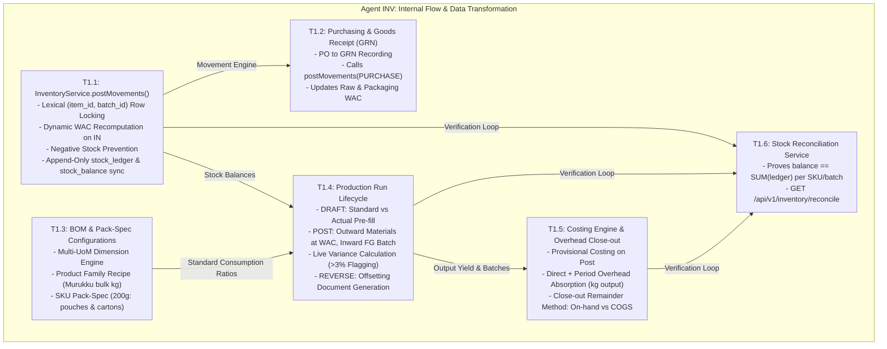
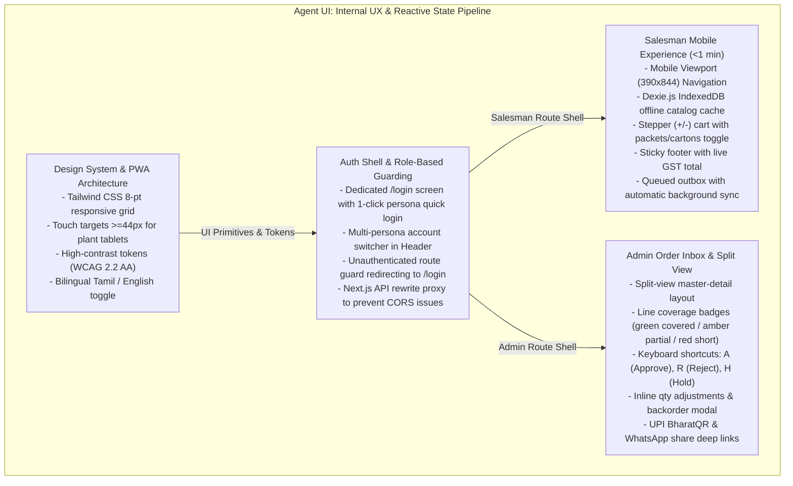
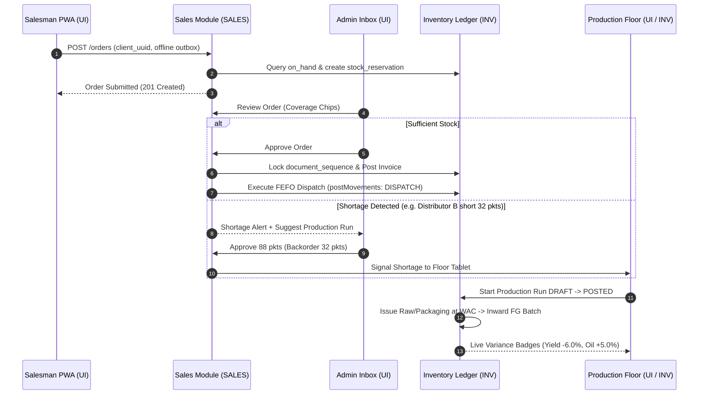

# SnackFlow — Code Tour & Live Defense Guide

**Purpose:** Comprehensive architectural walkthrough explaining every module, engineering decision, and design trade-off to enable confident defense in technical interviews and code evaluations.  
**System:** SnackFlow (Order-to-Audit ERP for Packaged Food Manufacturing)  
**Package Namespace:** `@snackflow/*` (`packages/shared`, `apps/api`, `apps/web`)  

---

## 1. Monorepo Architecture & Directory Map

```text
SnackFlow/
├── packages/
│   └── shared/                 # Pure TypeScript domain engines (Dual CJS/ESM)
│       ├── src/
│       │   ├── money/          # Decimal arithmetic & rounding wrappers
│       │   ├── uom/            # Multi-UoM conversion engine
│       │   ├── gst/            # Intra vs Inter-state CGST/SGST/IGST tax engine
│       │   ├── gstin/          # Mod-36 checksum & state code parser
│       │   ├── variance/       # Standard vs actual ±3% variance evaluator
│       │   ├── statemachines/  # Pure state transition validators
│       │   ├── permissions/    # Exhaustive 5-role RBAC permission matrix
│       │   └── numbering/      # Asia/Kolkata financial year sequence formatter
├── apps/
│   ├── api/                    # NestJS 10 Enterprise HTTP API & Worker
│   │   ├── prisma/             # Prisma 6 schema, triggers, and master seed
│   │   ├── src/
│   │   │   ├── core/           # Default-deny guards, RFC 7807 filters, Zod pipe
│   │   │   ├── prisma/         # Dual providers: PrismaService & PrismaReadService
│   │   │   ├── modules/        # Domain modules: Inventory, Sales, Billing, Production...
│   │   │   ├── config/         # Zod-validated environment contract
│   │   │   └── main.worker.ts  # BullMQ background job processor
│   │   └── test/               # Concurrency, RBAC, benchmark, integration suites
│   └── web/                    # Next.js 15 PWA App Router
│       ├── src/
│       │   ├── app/            # Persona routes: /sales, /admin, /production, /audit, /owner
│       │   ├── components/     # UI primitives & Header with language/persona switchers
│       │   └── lib/            # Dexie.js offline database & typed API client
├── docker/                     # Postgres 16 init scripts & role privileges
├── docker-compose.yml          # Offline evaluator container orchestration
└── docs/                       # Architecture, ADRs, design notes, demo scripts
```

---

## 2. Shared Domain Package (`@snackflow/shared`)

### Why a Separate Shared Package?
**Anti-Redundancy Invariant:** Business math (tax calculations, unit conversions, financial year sequences, variance percentages, permissions) must have exactly **one home**. 

If a salesman on mobile and the backend server calculate GST differently due to JavaScript floating-point errors, invoices will fail compliance audits. `@snackflow/shared` compiles to dual CJS and ESM formats with full `.d.ts` types and is imported by both `apps/api` and `apps/web`.

### Key Modules:
- **`money/index.ts`:** Wraps `decimal.js`. Provides `toDecimal()`, `roundMoney()` (`ROUND_HALF_UP` to 2 decimal places for INR), `roundQuantity()` (4 decimal places), and `roundCost()` (6 decimal places for moving WAC). The repository enforces a custom ESLint AST rule banning `parseFloat()` or `Number()` on monetary values.
- **`gst/index.ts`:** Pure functional tax splitter. Given quantity, rate, GST rate (e.g. 5%), and whether the transaction is inter-state:
  - Intra-state (Tamil Nadu to Tamil Nadu): CGST = 2.5%, SGST = 2.5%, IGST = 0%.
  - Inter-state (Tamil Nadu to Karnataka): CGST = 0%, SGST = 0%, IGST = 5.0%.
- **`numbering/index.ts`:** Implements `getFinancialYear(date, 'Asia/Kolkata')`. Correctly handles FY cutoff (1 April) regardless of whether the hosting server runs in UTC or IST. Generates sequence format `INV/2627/00001`.
- **`permissions/index.ts`:** Strongly-typed permissions enum and role-permission map for all 5 roles (`SALESMAN`, `ADMIN`, `PRODUCTION`, `AUDITOR`, `OWNER`).

---

## 3. The Append-Only Inventory Ledger Engine (`apps/api`)

### `InventoryService.postMovements()` — The Core Invariant
In traditional ERPs, developers frequently run `UPDATE stock_balance SET qty = qty - 10`. This makes forensic audits impossible if discrepancies emerge. 

In SnackFlow:
1. **`stock_ledger` is append-only:** Enforced by PostgreSQL trigger `trg_stock_ledger_append_only`. Any `UPDATE` or `DELETE` statement triggers a database exception.
2. **`stock_balance` is a cached projection:** It reflects `SUM(stock_ledger)`.
3. **`postMovements()` is the ONLY door:** No other service or controller in the entire codebase touches inventory records.

### Concurrency & Deadlock Elimination
```typescript
// Sort keys deterministically to eliminate deadlock in concurrent transactions
const sortedKeys = Array.from(neededMap.keys()).sort();

for (const key of sortedKeys) {
  const [itemId, batchId] = key.split('::');
  // Row-level exclusive lock prevents race condition
  await tx.$queryRaw`
    SELECT id, qty 
    FROM stock_balance 
    WHERE item_id = ${itemId}::uuid 
      AND (batch_id = ${batchId}::uuid OR (${batchId} IS NULL AND batch_id IS NULL))
    FOR UPDATE
  `;
}
```
If two salesmen simultaneously dispatch the final 50 packets of Murukku, transaction sorting and row locks guarantee that the first transaction checks stock and succeeds, while the second transaction waits and then cleanly fails with `400 Insufficient Stock`, preventing negative inventory.

---

## 4. Production Lifecycle & Costing Mechanics

### 4-Phase Run State Machine:
1. **DRAFT:** Pre-fills standard recipe inputs based on recipe lines and requested batch factor.
2. **POSTED:** Issues raw materials and packaging from stock at moving WAC. Generates finished goods batch with sequential batch code `MUR200-YYMMDD-NN`. Computes consumption and yield variances:
   $$\text{Variance \%} = \frac{\text{Actual} - \text{Standard}}{\text{Standard}} \times 100$$
   Deviations $> \pm 3.0\%$ are flagged in the database (`flagged: true`) and surfaced as system alerts.
3. **CLOSED:** Finalizes run by absorbing overheads (labor, electricity, fuel). Implements the **Remainder Method** to allocate overheads between on-hand inventory and already-dispatched COGS without paise rounding errors.
4. **REVERSED:** Reversing a posted run creates offsetting opposite ledger movements (`REVERSAL`), restoring issued ingredients to inventory and invalidating the finished goods batch.

---

## 5. Security & Authentication Architecture

### Defence in Depth:
1. **Default-Deny RBAC:** The global NestJS `RbacGuard` inspects every incoming route. Unless a route is explicitly decorated with `@Public()` or `@RequirePermission(...)`, the request is automatically rejected with HTTP 403 Forbidden.
2. **PostgreSQL Role Separation:**
   - `app_runtime`: Used by API services. Can read/write operational tables, but has database-level `REVOKE UPDATE, DELETE` on `stock_ledger` and `audit_log`.
   - `app_readonly`: Used by reports, dashboard, and auditor queries via `PrismaReadService`. Has strict `SELECT`-only privileges across all tables.
3. **Argon2id Hashing:** Password hashing uses RFC 9106 Argon2id parameters (`memoryCost: 65536, timeCost: 3`).
4. **HMAC-Signed Expiring Links:** Invoices can be shared publicly via WhatsApp without login using expiring HMAC-SHA256 signatures validated with constant-time equality checks (`crypto.timingSafeEqual`).

---

## 6. Front-End Architecture (`apps/web`)

### Persona-Driven Navigation:
The Next.js 15 App Router provides tailored interfaces for the 5 roles:
- **Salesman (`/sales`):** Optimized for $390 \times 844$ mobile viewport. Dexie.js IndexedDB catalog cache enables full offline order capture with background synchronization.
- **Admin (`/admin/orders`):** Desktop split view with live line coverage chips (Green = Fully Covered, Amber = Partial, Red = Short), keyboard accelerators (`A` approve, `R` reject, `H` hold), and one-click invoice posting.
- **Production (`/production`):** Industrial tablet layout with touch targets $\ge 44\text{px}$, BOM auto-fill, and live variance alerts.
- **Auditor (`/audit`):** Read-only verification hub with reconciled invariant indicators and one-click Excel/CSV report exports.
- **Owner (`/owner`):** Executive KPI cards, Ind AS 2 WAC vs FIFO sensitivity table, and debtor ageing.

---

## 7. How to Defend This in an Interview (Quick FAQs)

**Q: Why didn't you use MongoDB?**  
> *"Food manufacturing with statutory GST compliance requires multi-line ACID transactions, pessimistic row locks (`SELECT ... FOR UPDATE`), and declarative database triggers. MongoDB lacks native append-only table triggers and exact fixed-precision `NUMERIC` types, creating substantial risks of rounding drift and double-spending under concurrent dispatches."*

**Q: How do you prevent floating-point rounding errors?**  
> *"JavaScript's standard `0.1 + 0.2 === 0.30000000000000004` float bug is unacceptable in statutory tax reporting. We use `decimal.js` throughout `@snackflow/shared` and store exact `NUMERIC(14,2)` for money, `NUMERIC(14,4)` for quantity, and `NUMERIC(14,6)` for WAC in PostgreSQL. Our custom ESLint rule actively fails the build if `parseFloat` is introduced."*

**Q: What happens if the server crashes while an order is being invoiced and dispatched?**  
> *"The entire sequence—document sequence increment, invoice generation, FEFO batch allocation, and ledger movement posting—runs inside a single atomic database transaction (`this.prisma.$transaction`). Either all records commit, or the transaction rolls back completely with zero orphaned states."*

---

## 8. Fine-Grained Internal Architecture & Task Flow Diagrams

### 8.1 Internal Task Flow within StreamINV (Inventory & Production)


### 8.2 Internal Task Flow within StreamSALES (Sales & Invoicing)

```mermaid
flowchart TD
  subgraph StreamSALES_Detailed["Agent SALES: Internal Flow & Document Progression"]
    SALES_1["T1.7: Parties & Price Lists<br/>- Customer/Supplier CRUD<br/>- State Code & Mod-36 GSTIN Validation<br/>- Tiered/Assigned Price Lists & Salesman Territory"]
    
    SALES_2["T1.8: Sales Order Ingestion & Idempotency<br/>- POST /orders with client_uuid deduplication<br/>- Line calculations (packages/shared)<br/>- Soft Stock Reservation (stock_reservation)"]
    
    SALES_3["T1.9: Shortage Resolution & Approval Engine<br/>- available = on_hand - reserved check<br/>- Full Approval / Backorder Generation / Hold / Reject<br/>- Shortage Hint to Production: short 32 pkts -> 1 batch"]
    
    SALES_4["T1.10: GST Invoicing & Document Sequencing<br/>- Lock document_sequence FOR UPDATE<br/>- Formats FY sequence: INV/2627/00001<br/>- Intra (CGST+SGST) vs Inter (IGST) split<br/>- Immutable POSTED status + @react-pdf/renderer"]
    
    SALES_5["T1.11: Dispatch Execution (FEFO)<br/>- Consumes earliest expiring batch first<br/>- Calls InventoryService.postMovements(DISPATCH)<br/>- Releases soft reservation & updates FG balance"]
    
    SALES_6["T1.12: Payments, Allocations & Credit Notes<br/>- Payment collection against customer<br/>- FIFO allocation to oldest unpaid invoices<br/>- Credit Note generation (cancels invoice + returns stock)"]

    SALES_1 -->|Party & Pricing Rules| SALES_2
    SALES_2 -->|Pending Reservations| SALES_3
    SALES_3 -->|Approved Orders| SALES_4
    SALES_4 -->|Posted Invoice Lines| SALES_5
    SALES_4 & SALES_5 -->|Receivables Ledger| SALES_6
  end
```


### 8.3 Internal UX & Reactive State Pipeline within StreamUI


### 8.4 Cross-Stream End-to-End Orchestration Sequence

