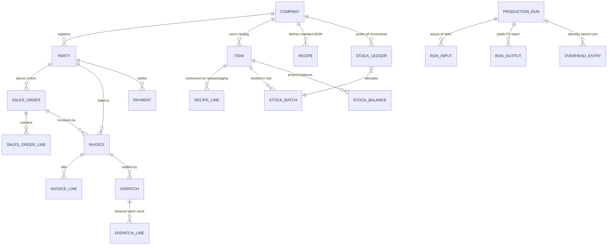

# SnackFlow — Technical Design Note

**System:** Order-to-Audit ERP for Packaged Food Manufacturing  
**Client:** Sri Murugan Snacks (Madurai, Tamil Nadu — GSTIN: `33AAAAA0000A1Z5`)  
**Standard Compliance:** Ind AS 2 (Inventories), CGST/SGST Act 2017, ISO 22000 Traceability  
**Target Submission:** NIT Trichy Centre for Development of Insights (CDI) Internship Evaluation  

---

## 1. Domain Architecture & Entity Relationship Overview

SnackFlow models the end-to-end manufacturing flow through an immutable, double-entry style domain graph. Data captured at the physical point of origin flows automatically into inventory, production, accounts receivable, and GST reporting with zero manual re-entry.



---

## 2. Inventory Ledger Mathematics & Immutability

### 2.1 Append-Only Ledger Invariant
Inventory balances in SnackFlow are strictly read projections of the append-only `stock_ledger` table. Balances are never manually edited. The invariant:
$$\text{StockBalance.qty} \equiv \sum_{i} \text{Ledger.qtyIn}_i - \sum_{j} \text{Ledger.qtyOut}_j$$
is enforced continuously.

To guarantee zero database tampering, an authoritative PostgreSQL trigger `trg_stock_ledger_append_only` rejects all `UPDATE` and `DELETE` queries at the database engine level:
```sql
CREATE OR REPLACE FUNCTION fn_prevent_stock_ledger_mutation()
RETURNS TRIGGER AS $$
BEGIN
    RAISE EXCEPTION 'Immutability violation: stock_ledger entries cannot be updated or deleted.';
END;
$$ LANGUAGE plpgsql;
```

### 2.2 Moving Weighted Average Cost (WAC) Formulation
Whenever raw materials or packaging items are received via a Goods Receipt Note (GRN), the moving WAC is recomputed dynamically before writing the `PURCHASE` movement:
$$\text{WAC}_{\text{new}} = \frac{(\text{Qty}_{\text{existing}} \times \text{WAC}_{\text{current}}) + (\text{Qty}_{\text{inward}} \times \text{UnitCost}_{\text{inward}})}{\text{Qty}_{\text{existing}} + \text{Qty}_{\text{inward}}}$$

*Example from Section 5 Benchmark:*
- Opening Stock: $100\text{ kg} \times \text{₹}42.00 = \text{₹}4,200.00$
- Inward GRN: $60\text{ kg} \times \text{₹}45.00 = \text{₹}2,700.00$
- Pooled Balance: $160\text{ kg}$, Total Value: $\text{₹}6,900.00$
- Recalculated WAC: $\text{₹}6,900 / 160 = \text{₹}43.125000\text{ / kg}$

### 2.3 Concurrency Control & Double-Spending Prevention
All stock mutations route exclusively through `InventoryService.postMovements()`. To eliminate race conditions during concurrent dispatches, rows in `stock_balance` are locked lexically using PostgreSQL `SELECT ... FOR UPDATE` sorted by `(item_id, batch_id)`. Sorting ensures a deterministic lock order across concurrent transactions, guaranteeing deadlock-free execution.

---

## 3. Production BOM & Variance Mechanics

### 3.1 Standard BOM vs. Actual Consumption
A standard recipe specifies consumption per standard batch ($B_0 = 1.0$, equivalent to 40 kg bulk Murukku producing 200 packets of 200g).

$$\text{StandardQty}_i = \text{RecipeLine.qty}_i \times \text{BatchFactor}$$
$$\text{VariancePct}_i = \left(\frac{\text{ActualQty}_i - \text{StandardQty}_i}{\text{StandardQty}_i}\right) \times 100$$

A tolerance threshold of $\pm 3.0\%$ triggers visual and operational variance flags:
1. **Flour:** Standard $40.0\text{ kg}$, Actual $40.0\text{ kg} \rightarrow \Delta = 0.0\%$ (Normal)
2. **Oil:** Standard $10.0\text{ L}$, Actual $10.5\text{ L} \rightarrow \Delta = +5.0\%$ (**Flagged Over-consumption**)
3. **Pouch Packaging:** Standard $188\text{ pkts}$ packed, Actual used $194\text{ pouches}$ ($188 + 6\text{ scrap}$) $\rightarrow \Delta = +3.19\%$ (**Flagged Scrap**)
4. **Overall Batch Yield:** Planned $200\text{ pkts}$, Actual $188\text{ pkts} \rightarrow \Delta = -6.00\%$ (**Flagged Yield Deficit**)

---

## 4. Costing & Overhead Remainder Close-Out (Ind AS 2)

### 4.1 Batch Cost Aggregation
Under Ind AS 2, cost of inventories comprises all costs of purchase, costs of conversion, and other costs incurred in bringing the inventories to their present location and condition.
$$\text{Total Batch Cost} = \sum \text{Direct Materials} + \sum \text{Direct Overheads} + \text{Absorbed Period Overheads}$$
$$\text{Cost Per Packet} = \frac{\text{Total Batch Cost}}{\text{Actual Output Packets}}$$

For Batch `MUR200-261120-01`:
- Direct Materials: Flour ($\text{₹}1,725.00$) + Oil ($\text{₹}1,470.00$) + Spices ($\text{₹}240.00$) + Pouches ($\text{₹}485.00$) + Cartons ($\text{₹}135.00$) = $\text{₹}4,055.00$
- Overheads Absorbed: $\text{₹}1,800.00$
- Total Cost: $\text{₹}5,855.00$ across $188\text{ packets} \rightarrow \mathbf{\text{₹}31.1436 / \text{packet}}$
- At wholesale price $\text{₹}50.00$: **Gross Margin = 37.7%** ($\text{₹}18.86/\text{packet}$).

### 4.2 Exact Paise Remainder Method
When 100 packets of the 188-packet batch are dispatched before final period overheads are entered, posting overheads retrospectively must not cause paise drift. SnackFlow calculates the on-hand fraction directly:
$$\text{OnHandShare} = \text{roundMoney}\left(\text{Overhead} \times \frac{\text{OnHandQty}}{\text{TotalProducedQty}}\right) = \text{roundMoney}\left(\text{₹}1,800 \times \frac{88}{188}\right) = \mathbf{\text{₹}842.55}$$
$$\text{COGSAdjustment} = \text{Overhead} - \text{OnHandShare} = \text{₹}1,800.00 - \text{₹}842.55 = \mathbf{\text{₹}957.45}$$
This guarantees that $\text{OnHandShare} + \text{COGSAdjustment} \equiv \text{TotalOverhead}$ down to the exact Indian paisa.
